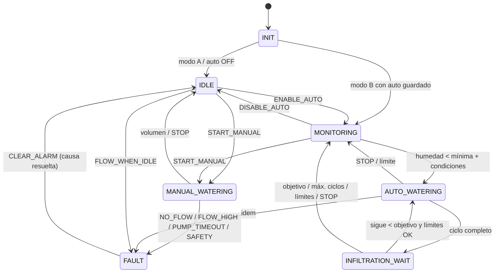

# Arquitectura del firmware

ESP-IDF 6.0.2, lenguaje C, ESP32 de doble núcleo. Sin PWM, sin PI/PID: bomba y válvula en ON/OFF y dosificación por pulsos del YF-S201.

## Módulos (`main/`)
| Módulo | Archivos | Responsabilidad |
|---|---|---|
| main | `app_main.c` | Orden de arranque seguro |
| tipos | `app_types.c/h` | Estados, motivos, resultados, decisiones y alarmas (sin dependencias de hardware) |
| placa | `board.c/h` | Mapa de pines y verificación de conflictos |
| actuators | `actuators.c/h` | GPIO de bomba y válvula, enclavamiento, habilitación de potencia, simulación, paro de emergencia |
| safety | `safety.c/h` | Supervisor independiente (`esp_timer` 100 ms): tope duro de bomba y vigilancia de la tarea de control |
| flow_sensor | `flow_sensor.c/h` | YF-S201 por PCNT con acumulación de 32 bits |
| soil_sensor | `soil_sensor.c/h` | EC-5: pulso de excitación, ADC1 calibrado, mediana, validez, %VWC |
| tank_level | `tank_level.c/h` | PING))): disparo y eco, mediana, estabilidad, % de nivel |
| environment_sensor | `environment_sensor.c/h` | DHT22: protocolo de 1 hilo, suma de verificación |
| sensors | `sensors.c/h` | Tarea en el núcleo 1 que agenda las mediciones y guarda una "foto" con mutex |
| simulation | `simulation.c/h` | Valores simulados (sensores, flujo, hora, aceleración del tiempo) |
| timekeeping | `timekeeping.c/h` | SNTP, zona de Chihuahua, minuto del día, clave del día |
| configuration | `configuration.c/h` | Parámetros, límites duros, validación de relaciones, NVS con CRC |
| storage | `storage.c/h` | Litros acumulados y diarios, marca de riego en curso, historial (NVS) |
| **irrigation_logic** | `irrigation_logic.c/h` | **Máquina de estados PURA**: decisiones, riego, infiltración, alarmas. Sin GPIO ni FreeRTOS |
| irrigation_controller | `irrigation_controller.c/h` | Tarea de control (núcleo 0, 20 ms): entradas → lógica → salidas, comandos, persistencia, JSON |
| commands | `commands.c/h` | Validación de comandos MQTT (JSON, id, duplicados, retenidos, antigüedad, token) |
| wifi_manager | `wifi_manager.c/h` | Estación Wi-Fi con reconexión y SNTP |
| mqtt_manager | `mqtt_manager.c/h` | esp-mqtt: LWT, suscripción, publicación en cola |
| console | `console.c/h` | Consola serial (comandos de texto, incluidos los locales) |
| selftest | `selftest.c/h` | 33 escenarios sobre la lógica pura con reloj virtual |

## Tareas
| Tarea | Núcleo | Prioridad | Periodo | Vigilancia |
|---|---|---|---|---|
| `control` | 0 | 5 | 20 ms | TWDT (5 s) + latido al supervisor |
| `sensors` | 1 | 4 | 50 ms (mediciones según intervalo) | — |
| `console` | 0 | 3 | evento UART | — |
| `safety` (esp_timer) | — | tarea esp_timer | 100 ms | — |
| esp-mqtt / Wi-Fi / lwIP | IDF | IDF | — | — |

Las esperas de µs de los drivers (DHT22 con sección crítica, eco del PING))), pulso del EC-5) corren en el núcleo 1 y no retrasan el control.

## Flujo de datos
```
 Sensores (núcleo 1) ──snapshot──┐
 YF-S201 (PCNT) ──pulsos─────────┤
 Hora (SNTP/simulada) ───────────┼─► irr_inputs_t ─► irrigation_logic (pura) ─► pump_cmd / valve_cmd ─► actuators ─► GPIO26/27
 Configuración (NVS) ────────────┘                     │ eventos                      ▲
 Comandos (MQTT / consola) ─► cola ─► controller ──────┘                              │
                     STOP ──► actuators_emergency_off() (inmediato) ──────────────────┘
 controller ─► storage (NVS) · mqtt (telemetry/state/decision/event/alarm/ack) · consola
 safety (100 ms) ─► actuators_emergency_off() si la bomba excede el tope o el control se cuelga
```

## Máquina de estados

Fases de cada riego: `OPENING` (válvula ON, 300 ms) → `PUMPING` (bomba ON, contando pulsos) → `CLOSING` (bomba OFF, 300 ms) → válvula OFF.

**Invariantes** (comprobadas en cada paso y en el SELFTEST): fuera de un riego no hay salidas activas, y nunca hay bomba sin válvula.

## Por qué la lógica es "pura"
`irrigation_logic.c` no llama a GPIO, ADC, NVS ni FreeRTOS. Recibe todo en `irr_inputs_t` (incluido el reloj) y devuelve órdenes y eventos. Así:
- el **SELFTEST** la ejecuta con entradas sintéticas y reloj virtual (15 min de infiltración en milisegundos), sin tocar salidas;
- la simulación (`SIM ON`) usa exactamente el mismo código que la operación real;
- es fácil de revisar y de ampliar.

## Persistencia (NVS)
| Clave | Contenido | Escrituras |
|---|---|---|
| `riego/cfg` | `riego_config_t` + CRC32 + versión | Solo al cambiar un parámetro |
| `riego/persist` | Litros totales y del día, día, marca de riego en curso, 16 entradas de historial, contador de arranques + CRC32 | Al iniciar y terminar cada riego, al cambiar de día y al arrancar |

## Componentes externos
- `espressif/mqtt` 1.1.0 (el mismo usado en `Practica4_MQTT`).
- `espressif/cjson` 1.7.19 (ESP-IDF 6 ya no incluye `json`).

## Tamaño (compilación de la placa)
- App: 0xF7580 bytes (~1.01 MB) de 0x177000 (1.5 MB): 34 % libre. Partición *single app large*, flash de 4 MB.
- Heap libre se publica en `state.free_heap`.
